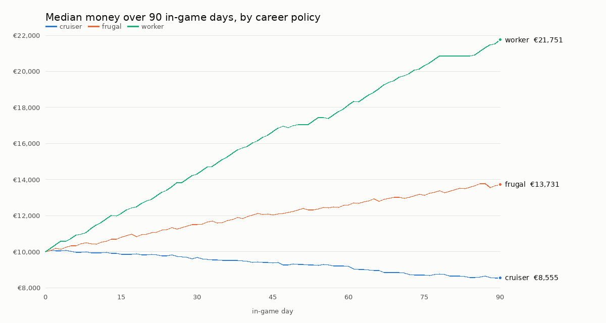

# I027 Tier 2 - Career findings (economy, before any repricing)

Career playtesting **Mode A** (fast careers on the real rules) was run with
`tests/career/career_sim.tscn`. The report is from
`python3 tools/qa/career_report.py docs/iterations/i027/career <batch dirs>`.

What this is, and what it is not:
- Every figure comes from a career's own books (`CareerLedger`) in the real
  game. Nothing was injected.
- These are automated strategies, **not human playtesting** (Part VII,
  Mode C remains the Captain's).
- **Build:** the Tier 2 working tree (`wip/i027-t2`, on top of Tier 1
  `93244d2`), standard career runner, 26 ft starter (Arctic Wanderer 26).
- **Seeds 1–5:** weather seed and the policy's harbour choices.
- **Length:** 90 in-game days each.
- **Batches:**
  - Standard: 3 policies × 5 seeds;
  - Relaxed and Seasoned: the frugal policy × 5 seeds.
- **Clocks, kept apart:**
  - wall-clock time: 14–51 s per career, headless Linux;
  - in-game time: 90–96 days;
  - estimated human time: 5–10 hours per career. This is a *model*: 8 min
    per harbour stop, 1 min per work session, and 3 s per game hour under way
    watched at 20×.

The policies:

| Policy | Remote work in harbour | Days per harbour | To windward | Refuel below | Hop |
|---|---|---|---|---|---|
| frugal | 4 h a day | 2 | beat under sail | 35 % | 20–70 nm |
| cruiser | 3 h a day | 1 | **motor** | 70 % | 25–90 nm |
| worker | 8 h a day | 3 | beat under sail | 50 % | 20–60 nm |

## Results

| Batch | Policy | Careers | End money: median (range) | Lowest money | Voyages | nm sail / engine | Fuel (L) | Est. human hours | Wall s | Stranded |
|---|---|---|---|---|---|---|---|---|---|---|
| std | cruiser | 5 | €8,542 (€8,409–€8,651) | €8,395 | 57 | 1621 / 2845 | 1362 | 9.7 | 45 | 0 |
| std | frugal | 5 | €13,805 (€12,854–€14,175) | €10,000 | 41 | 1310 / 1242 | 571 | 7.4 | 21 | 0 |
| std | worker | 5 | €21,693 (€21,505–€22,946) | €10,000 | 26 | 854 / 921 | 416 | 5.2 | 15 | 0 |
| relaxed | frugal | 5 | €20,244 (€19,203–€20,494) | €15,000 | 41 | 1208 / 1255 | 561 | 7.3 | 21 | 0 |
| seasoned | frugal | 5 | €9,266 (€8,231–€9,784) | €7,000 | 41 | 1233 / 1231 | 578 | 7.4 | 23 | 0 |

Income (+) and costs (−) by source, median over the careers, in euros:

| Batch | Policy | fuel | harbour dues | provisions | remote work |
|---|---|---|---|---|---|
| std | cruiser | −2,883 | −961 | −1,753 | +4,275 |
| std | frugal | −1,200 | −1,356 | −1,730 | +8,200 |
| std | worker | −833 | −1,434 | −1,770 | +15,600 |
| relaxed | frugal | −874 | −1,063 | −994 | +8,200 |
| seasoned | frugal | −1,464 | −1,688 | −2,596 | +8,200 |

Raw data: `docs/iterations/i027/career/summary.csv` (one row per career) and
`report.md`. The per-career JSON (books, voyage log, daily snapshots) is
reproducible from the same seeds and was not committed.

## What it says, in plain words

1. **Nobody was stranded.** No career ran out of money, food or fuel, and none
   went below its starting money except the cruiser. The suite separately
   proves the low-money paths: dues waived beyond the money, fuel bought with
   what there is, and sails when the tank is dry.
2. **A frugal life afloat costs about €48 a day** on the 26 ft at Standard:
   - fuel about €13;
   - harbour dues about €15;
   - provisions about €19.

   Four hours of remote work a day (€100) covers that with room to save.
3. **The choice to windward is now a real cost.** Motoring to windward and
   moving every day, the cruiser burns about €32 of fuel a day and spends
   more than it earns at 3 hours of work. It loses about €1,450 in 90 days:
   slow, never a crisis.
4. **Fuel is used even by frugal sailors.** About half of their miles are
   under engine: calms, harbour approaches (the boat keeps to its line there),
   and light airs below the engine-start threshold. That feels right for a
   26 ft cruiser in Danish and German waters.
5. **Difficulty works as intended.**
   - Relaxed frugal gains about €5,200 in 90 days.
   - Standard gains about €3,800.
   - Seasoned gains about €2,300, starting from €7,000.
6. **Remote work is the only material income, and nothing limits it but the
   8 hours a day.** The worker (8 hours a day) more than doubles its money in
   90 days. **This is the finding that matters for I028.** If unchanged,
   paying passengers would be an optional extra, not the important income the
   commission wants (point 17: avoid limitless alternate income that
   trivialises passengers).

## Not yet exercised (honest gaps)

- **Boat care, equipment and boat purchases.** No policy visits the yard or
  buys anything yet, so engine hours and rig wear accumulate unpaid in these
  careers. That is a policy gap, not a game one. It is the next step for the
  harness: a service when advised, an upgrade target, a boat-purchase target.
- **Only the starter boat** and 90 days. Larger boats' running costs,
  "time to next boat" and the 20–100 hour horizons come with Tier 3 (boat
  data) and the passenger economy in I028.
- **No fishing or publishing** income in these policies.

## Proposals - none applied (the Captain decides)

Classified as the commission asks (84):

1. **Genuine bugs and exploits.** None found in these runs.
2. **Strongly supported adjustments.** None needed before I028. The running
   costs are moderate, predictable and recoverable, as asked.
3. **Subjective choices for the Captain** (evidence above, for I028):

| Item | Today | Possible change | Why | Expected impact | Side effects |
|---|---|---|---|---|---|
| Remote work | €25/h, up to 8 h every harbour day, unlimited days | When passengers arrive in I028: a weekly cap (e.g. 20 h a week), or pay that falls with hours worked in a week | Point 6: it out-earns everything and would make passengers optional | Passengers become the main way to grow; remote work stays a safety net | Low-money recovery slows; keep Relaxed generous |
| Engine-start threshold | 3.5 kn potential | Leave as is | Half the miles under engine is plausible for a 26 ft | — | — |
| Harbour dues | €1.60–3.20 per metre and night | Leave as is | About €15 a night on the 26 ft; anchoring stays free | — | — |

The same seeds will be rerun after any approved change, and the before and
after compared.

## Re-measured after the Tier 4 propulsion fix

Tier 4 found and fixed a sailing bug. The engine stayed on in a beam
reach whenever the wind could not drive the boat past 6 kn, while the
26 ft's engine only makes 5 kn. A single probe, Copenhagen to Kiel, went
from 102 nm under engine to 7. The same batches were therefore run again
on the fixed build: the same seeds, policies, difficulties and 90 days.

| Batch | Policy | End money, median: before → after | nm sail / engine: before → after | Fuel (L) |
|---|---|---|---|---|
| std | cruiser | €8,542 → €8,843 | 1621 / 2845 → 2038 / 2665 | 1362 → 1273 |
| std | frugal | €13,805 → €13,590 | 1310 / 1242 → 1290 / 1299 | 571 → 599 |
| std | worker | €21,693 → €22,086 | 854 / 921 → 837 / 866 | 416 → 389 |
| relaxed | frugal | €20,244 → €19,995 | 1208 / 1255 → 1286 / 1285 | 561 → 574 |
| seasoned | frugal | €9,266 → €9,294 | 1233 / 1231 → 1286 / 1218 | 578 → 572 |

**The findings above stand.**
- Only the cruiser, which motors to windward, moved noticeably: about 400
  more miles under sail and €300 better off.
- For the other policies the difference is within the spread between
  seeds.
- About half of the miles are still under engine. That comes from calms,
  light airs below the engine-start threshold and harbour approaches, as
  finding 3 says, not from the bug.
- Remote work remains the only material income.

Raw data: [career_t4/tier2](career_t4/tier2/report.md).
