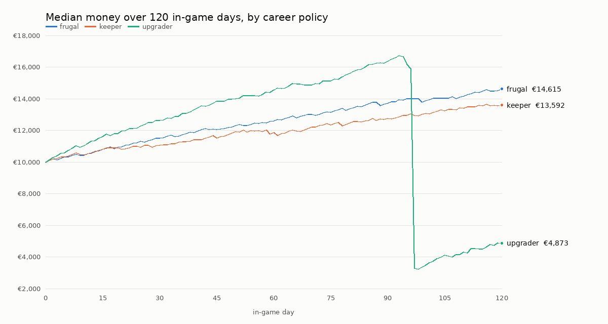

# I027 Tier 3 - Career findings: boat care and a real boat purchase

Career playtesting **Mode A**, the next increment the Captain asked for.

What this is, and what it is not:
- These are automated strategies on the real rules, **not human playtesting**
  and not proof of full-career balance (120 in-game days, one starter boat,
  one purchase).
- Every figure comes from the careers' own books (`CareerLedger`); nothing
  was injected.
- **How to reproduce:** `tests/career/career_sim.tscn` with
  `--seeds=1,2,3,4,5 --days=120 --policies=frugal,keeper,upgrader`, then
  `python3 tools/qa/career_report.py docs/iterations/i027/career_t3 <batch>`.
- **Build:** the Tier 3 working tree (`BH · i027_02 · DEV · 53c8e5f` plus the
  Tier 3 changes; the label's stage was raised to 03 afterwards). Standard
  difficulty, 26 ft starter.
- **Clocks, kept apart:**
  - wall clock: 32-43 s per career, headless Linux;
  - in-game: 120-126 days;
  - **estimated** human time: 8.9-9.4 hours per career. This is a model, not
    a measurement: 8 min per harbour stop, 1 min per work session, 3 s per
    game hour under way at 20×.

The policies:
- **frugal:** Tier 2's, unchanged (no boatyard visits).
- **keeper:** frugal, plus every service the boatyard advises (recommended
  or needed) wherever there is a boatyard, and a haul-out when the bottom
  wants one where a harbour offers it.
- **upgrader:** 6 hours of remote work a day, the same care, and saving for
  the Wing 33 (€14,000). It buys the boat and moves aboard once the money
  covers the price plus a €3,000 reserve, at a harbour with a boatyard.

## Results

| Policy | Careers | End money: median (range) | Lowest money | Services done (median) | Bought the Wing 33 | Day bought (median) | Stranded |
|---|---|---|---|---|---|---|---|
| frugal | 5 | €14,564 (€13,828-€14,990) | €10,000 | 0 | - | - | 0 |
| keeper | 5 | €13,654 (€13,327-€14,127) | €10,000 | 6 | - | - | 0 |
| upgrader | 5 | €4,824 (€3,562-€5,331) | €2,985 | 5 | 5 of 5 | 96 (94-113) | 0 |

Costs (−) and income (+) by source, median, euros, over 120 days:

| Policy | boat purchase | fuel | harbour dues | maintenance | provisions | remote work |
|---|---|---|---|---|---|---|
| frugal | 0 | −1,741 | −1,771 | 0 | −2,286 | +10,400 |
| keeper | 0 | −1,809 | −1,698 | −714 | −2,328 | +10,200 |
| upgrader | −14,000 | −1,352 | −1,927 | −601 | −2,289 | +14,700 |

Raw data: [career_t3/summary.csv](career_t3/summary.csv) and
[career_t3/report.md](career_t3/report.md).

## What it says

1. **Looking after the boat is affordable.** Doing everything the boatyard
   advises costs the 26 ft about **€6 a day** (€714 over 120 days, six
   services: repairs, rig and engine). The keeper ends about €900 behind the
   frugal sailor. That is about what a cruiser expects to spend, and it is
   never a crisis.
2. **The first upgrade is reachable, and it is felt.**
   - Working 6 hours a day, every career bought the Wing 33, on day 94-113.
   - By the estimate model that is about **7-8 hours of a player's time**.
   - The purchase leaves €3,500-5,300, and nobody was stranded afterwards.
3. **The bigger boat costs more to keep.** On the Wing 33 the dues per night
   rise by about 28 % (length) and the burn by about 45 %. The upgrader's dues
   were the highest of the three, although it spent part of the time on the
   26 ft.
4. **The time to the first upgrade is short** because remote work (Tier 2's
   finding) is the only material income. The Captain approved making it
   supplementary once I028's passenger revenue exists. These figures are the
   baseline for that comparison. Nothing has been changed.

## Not yet exercised (honest gaps)

- **Haul-outs.** No keeper hauled out in 120 days. The bottom becomes
  "recommended" after about 50 days, but a haul-out needs a harbour with a
  travel lift, and these policies only care for the boat where they happen
  to stop. Next harness step: seek a haul-out yard when the bottom asks.
- **Equipment upgrades** (the chandlery, instruments, hard antifouling): not
  bought by any policy yet.
- **Larger boats from the start, the catamaran, and careers beyond 120
  days.** These come with I028's passenger income, when "time to the next
  boat" has a second source of money to compare.
