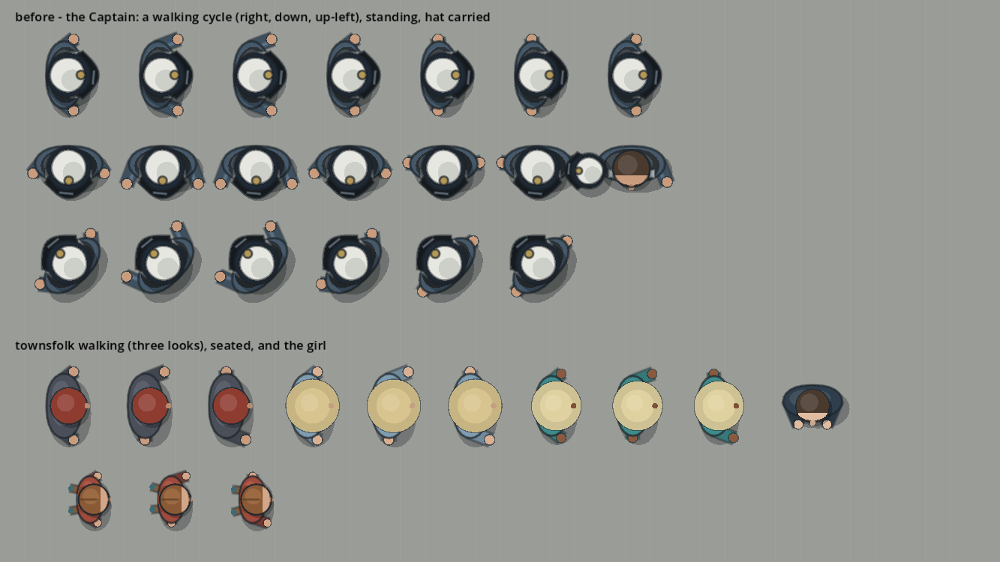
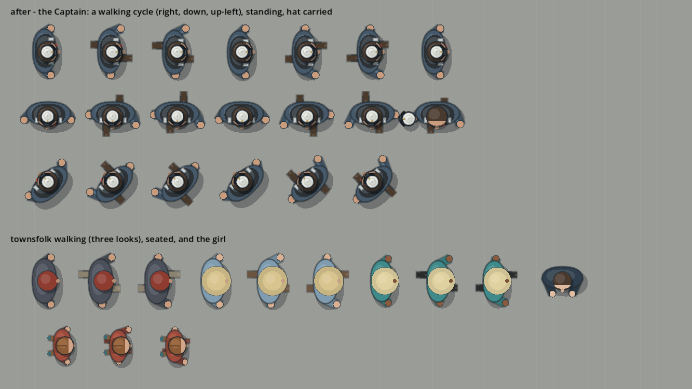
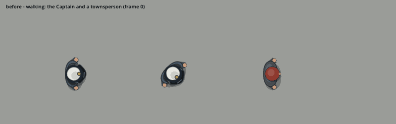
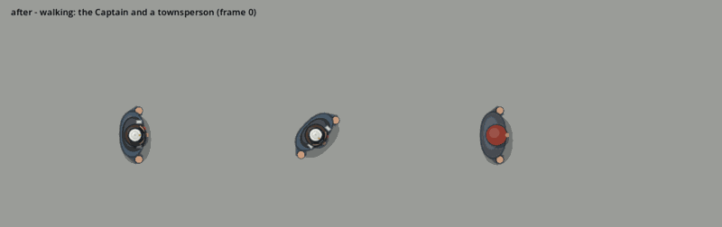

# I027 Tier 4 - People who belong to the world

The Captain's added requirement after the Tier 2 gate: characters with the
illustrated world's proportions and restrained shading, a credible hat, and
a real alternating walk that every person shares, each keeping their own
look. Done at the core-integration stage, as recorded in
[DESIGN.md](DESIGN.md).

## Before and after

The sheets are drawn by the game's own code: the Captain walking in three
directions, standing, and carrying the hat; three townsfolk; one seated;
and the girl on the pontoon. `tests/character_sheet_i027.tscn` draws them
with whichever version of the drawing code is checked out.

| Before (I026) | After |
|---|---|
|  |  |
|  |  |

## What changed

- **One human walk: `HumanGait` (`src/player/human_gait.gd`).** The Captain,
  the townsfolk and the girl use it. Each keeps their own clothes, size and
  stride.
  - **Cadence follows speed.** The step advances with the distance walked,
    not with time, so a slower walk takes slower steps and nobody skates.
    One stride is 56 px for an adult and 34 px for the child.
  - **Opposite arm and leg.** The arms swing against the legs. Before, both
    arms swung together.
  - **Grounded feet.**
    - A shoe and a short trouser cuff show under the body, only slightly
      visible from above.
    - The planted foot moves back under the body and never forward.
    - The reach was kept short (0.27 of the stride). That reads as feet
      rather than legs, but at full speed the planted foot creeps back a
      little rather than standing perfectly still: a deliberate compromise,
      covered by the test below.
  - **Weight transfer.** The body leans a little toward the planted foot.
  - **Settling into idle.** The walk eases in when the person starts and
    out when they stop (no snap to a standing pose). Turning keeps the
    phase, so a turn does not restart the step.
  - **Every direction.** The step is drawn along the facing, so straight,
    diagonal and reverse walks share one cycle.
- **Proportions.**
  - Smaller heads: the Captain 7.6, the townsfolk 7.2, the girl 6.6.
  - Narrower shoulders.
  - Gentler shading: the outline ink alpha is 0.55.
  - Trousers and shoes added to the townsfolk's existing looks; their
    colours are unchanged.
- **Hand positions are computed once (`SailorDrawing.hand_positions`).**
  This fixed a bug where the side offset was applied twice. The mug, the
  carried hat and the arm drawing read the same hands.
- **The hat (`src/hat/hat_drawing.gd`).**
  - Redrawn finer and lighter, with a crown 0.76 of the brim, crown
    stitching and a small badge.
  - Worn size 12.5, blowing size 20.
  - Carried at 0.28 scale.
  - Still recognisably the Captain's hat.
- **Unchanged:** the animals (cat, dog, parrot and dock animals), all
  collision shapes, interaction areas, walking speeds and routes.

## Acceptance (Linux, rendered)

| Check | Result |
|---|---|
| Normal and diagonal walking, starting, stopping, turning | `test_living_world`: the arms swing opposite each other and the legs, the planted foot moves back and never forward, standing feet sit side by side. The ease in and out (`HumanGait.ease_amount`) is seen in the GIFs; no test covers it |
| Cadence in step with speed | The phase comes from the distance walked (`HumanGait.advance`); checked by `test_living_world` |
| 100 % and 130 % interface scale | People are drawn in the world, not the interface, so the scale does not touch them; the 130 % suites pass unchanged |
| Cabins, decks, pontoons, waterfront, shops and café | The rendered character suites (deck, cabin, dock girl, quay, café, harbour life, waterfront walkthrough): 924 checks passed |
| No collision or interaction regressions | No collision or interaction shape was changed; the walkthrough, quay and café suites pass |
| Animals untouched | No companion or animal drawing file changed |

**Still to check on Windows:** the walk at normal speed on a real display,
at 100 % and 130 %. The GIFs are captured frame by frame in this container,
which has no GPU.
