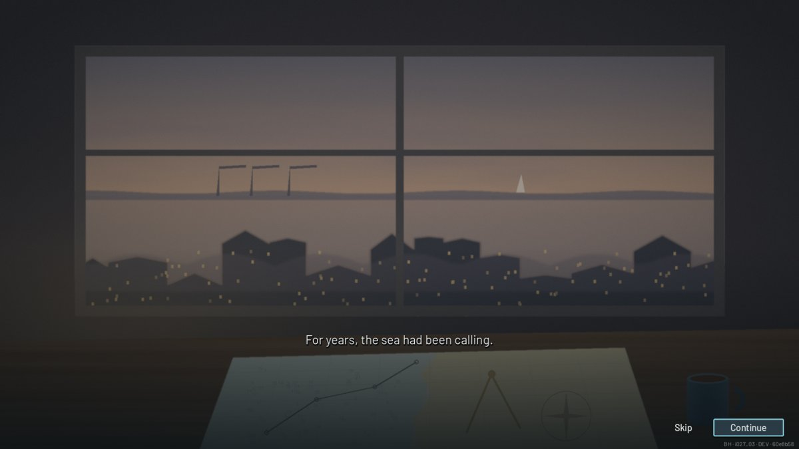
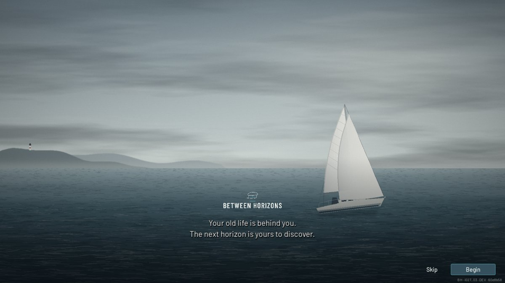

# I027 Tier 4 - The opening story and the working title

## The opening story

A short prologue, shown when a new game begins from the title screen's
**New Game**. It uses the Captain's approved script without rewording,
paced over eight pages and three illustrated stills:

| Pages | Still | Words |
|---|---|---|
| 1-3 | A desk by a city window at dusk: a chart with a pencilled course, dividers, a mug (`assets/opening/desk_at_dusk.png`) | "For years, the sea had been calling." … "You were no stranger to sailing …" |
| 4-6 | The boat waiting at a pontoon at dawn, a duffel bag on the planks (`assets/opening/harbour_dawn.png`) | "Until one day …" … "Perhaps you could earn your living …" |
| 7-8 | The open sea (the title scene) and the wordmark | "And perhaps …" "Your old life is behind you. The next horizon is yours to discover." |

- **Turning the page:** click, Space, Enter or Continue. The pictures
  cross-fade and drift slowly (3 % over a page).
- **Skipping:** Skip or Esc ends the story at once.
- **Where it ends:** aboard, in the cabin, and the Captain is free to play.
  There is no contract or quest. When the First Voyage offer is due (the
  first new game on a computer), it comes after the story.
- **No replay:**
  - The story is told only from New Game.
  - Loading a save or Continue never shows it, so existing saves don't
    replay it.
  - Nothing new is saved (SAVE_VERSION stays 12).
- **While it shows:** the game is paused underneath, so the clock stands
  still.
- **Languages:** every page is in English and Danish.
- **Pictures:** painted by `tools/branding/paint_opening_scenes.py` in the
  title scene's style.
- **Code:**
  - `src/ui/opening_story.gd` (`OpeningStory`, a modal);
  - `App.play_opening()`, called from the New Game dialog's start.
- **Tests:** `test_opening` (rendered).
  - It checks:
    - the script and the stills;
    - Danish;
    - paging by button and by click;
    - the paused clock;
    - the end in the cabin;
    - Esc and Skip;
    - load and Continue never showing the story.
  - The test runner turns the story off for the other suites
    (`OpeningStory.enabled`), as it does with the First Voyage offer.

### The Captain is a seasoned sailor

The script says so twice: "You were no stranger to sailing" and "the
experience to know". The Academy (Handbook, First Voyage, tips) was
audited. It teaches the player this game's controls (walk, the action
wheel, the chart, the tiller keys) and never casts the Captain as a
beginner, so it needed no change.

## The working title: Between Horizons

- **One source:** `GameVersion.DISPLAY_NAME` holds the name.
  `GameVersion.LOGO_PATH` / `LOGO_SMALL_PATH` hold the wordmark, and
  `GameVersion.TAGLINE` holds "The next horizon is yours to discover."
  These read from it:
  - the title screen (logo and tagline);
  - the loading screen;
  - the opening's last page;
  - the session log's `game` field.
- **Window title:** project.godot's `application/config/name` is
  "Between Horizons". `test_branding` keeps it equal to `DISPLAY_NAME`. The
  boot splash shows the new wordmark.
- **Wordmark:** `assets/branding/between_horizons_logo*.svg` and PNG
  exports, made by the same generator as before
  (`tools/branding/make_horizon_branding.py`, `tools/export_branding.gd`).
  It uses the same cap line drawing and type.
- **Unchanged on purpose:**
  - the save folder (`Little Captains Hat`);
  - the save format id (`next_harbor_save`);
  - the repository and its URL;
  - internal ids and save keys;
  - the application icon (the hat);
  - the Little Captain's Hat and Next Harbor logo files (kept for history);
  - the historical release branches.
- **Save error:** "This is not a … save file" no longer names a game, so it
  stays right whatever the final name is.

### The naming conflict (for the Captain)

A commercially released video game is already called **Between Horizons**.
Here the name is a creative working title only: it is used in the working
build, the title screen, the opening and the development documents. Nothing
claims a trademark or commercial availability. There are no export presets,
store pages, installers or marketing assets. **Before any public
distribution metadata, the Captain needs to make the legal and commercial
naming decision.** No substitute title has been chosen. Changing the name
later means editing `GameVersion.DISPLAY_NAME`, project.godot's
`config/name`, and running the wordmark generator again.
