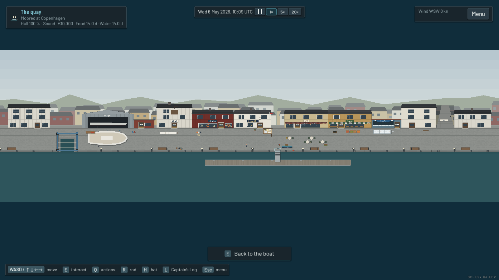
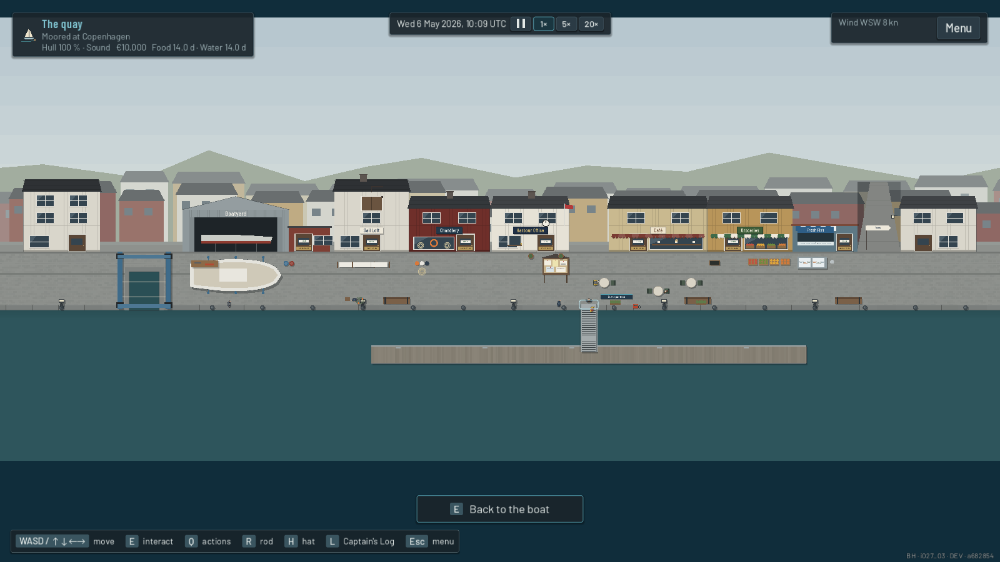

# I027 Tier 4 - The compact waterfront, and the developer menu on the quay

Both came from the Captain's Windows playtesting after Tier 3.

## 1. The developer menu did not open on the quay (fixed)

- **Cause:** F10 (the developer test panel) was allowed only in the boat
  (deck and cabin) and on the chart. When the quay arrived in I026 as a
  screen of its own (`HarbourFront`), it was never added. Nothing swallowed
  the key: the quay only takes keys while the Captain sits at the café.
- **Fix:** `App.toggle_dev_tests()` now also allows the quay. The panel's
  buttons act on the game state (weather, condition, money, time), so they
  are safe there. It still never opens over another window, and a player's
  build still has no panel.
- **Regression check** (`test_upkeep_ui`, rendered, a real F10 key press):
  - the panel opens and closes on the deck, in the cabin, on the quay and on
    the chart;
  - on the quay it does not open over the fuel menu;
  - run against the old code, the check fails (quay: false); with the fix it
    passes.

## 2. Believable human scale, compressed environmental scale

**Unchanged (true scale):** the Captain and the townsfolk, doors (about a
metre), the walkway and gangway, the fuel pump, the café's tables and
chairs, signs.

**Compressed:**

| | Before | After |
|---|---|---|
| Boatyard | 12.5-14 m | 8.6-9.4 m |
| Sail loft | 6-6.8 m | 4.3-4.7 m |
| Chandlery | 7-8 m | 4.6-5.2 m |
| Harbour office | 6.2-7 m | 4.4-4.9 m |
| Café | 7.6-8.6 m | 5.8-6.4 m (three terrace tables) |
| Grocery | 7-8 m | 4.6-5.2 m |
| Fishmonger | 5.2-5.8 m | 3.8-4.2 m |
| Ordinary houses | 5.6-7.6 m, up to five | 3.8-4.6 m, one at each end |
| Travel lift's dock | 5.2 m | 4.6 m |
| Promenade depth | 4.2 m | 3.5 m |
| Gaps between buildings | up to 0.8 m | up to 0.4 m |

**One open walking lane** now runs along the whole quay, past every door.
- No table, board, bench, stall or hull stands in it. Each door's area
  reaches down to it, so walking past a door lights it up.
- The shops' own things stay above the lane (the sail loft's sailcloth, the
  fish stall, the yard's workbench), and the café's terrace below it.
- The noticeboard moved to the water side of the lane, by the walkway's head.
- The yacht on stands in the boatyard is a little smaller. It leaves a lane
  along the coping, and lamps no longer stand in it, as benches already did
  not.

**Unchanged in behaviour:**
- every shop's menu and backend;
- opening hours and the closed-door wait;
- the after-hours hatch;
- the café seat;
- the townsfolk's routines;
- the travel lift's haul-out;
- the fuel berth;
- saves (the quay is a screen, not saved).

### The walking experience, measured

Walks were measured with `tests/screenshots_i027_waterfront.tscn`, in a
rendered game at normal speed with the movement keys held, from the
walkway's head until the door lit up. The "before" walked just below the
doorsteps, as there was no lane. Copenhagen:

| To | Before | After |
|---|---|---|
| Harbour office | 2.2 s | 1.5 s |
| Café | 2.3 s | 1.7 s |
| Chandlery | 4.9 s | 3.5 s |
| Grocery | 5.4 s | 3.9 s |
| Sail loft | 8.3 s | 5.7 s |
| Fishmonger | 8.7 s | 6.1 s |
| Boatyard | 10.5 s | 7.3 s |

| Quay | Before | After |
|---|---|---|
| Copenhagen | 87.0 m | 57.7 m |
| Lohals | 62.9 m | 34.5 m |
| Naples | 89.1 m | 57.4 m |

From the fishmonger to the boatyard is now about 31 m (it was 43 m).

### Checks

`test_living_harbours`:
- **Compact quays:** in every harbour, at most 62 m long, every door within
  19 m of the walkway.
- **Lane:** a person-sized probe swept along the lane touches nothing from
  the first door to the last, and every door lights up from it.
- **I026's checks:** every door and station (hatch, noticeboard, lane into
  town, travel lift, fuel pump) can be walked to from the walkway, and a door
  is still about a metre beside the Captain.

`test_waterfront_walkthrough`: I026's key-driven play from the main menu to
the shops and the café still passes.

### Before and after

Screenshots are in `docs/screenshots/i027/tier4/waterfront`:
- `before_*` and `after_*`;
- Copenhagen, Lohals (a small harbour) and Naples (Mediterranean);
- the whole quay at once (`*_overview`) and the walkway's head at the game's
  own zoom (`*_walkway`).

